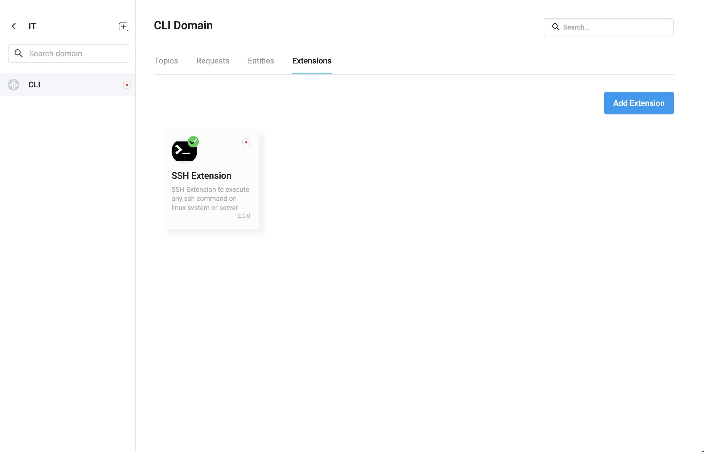
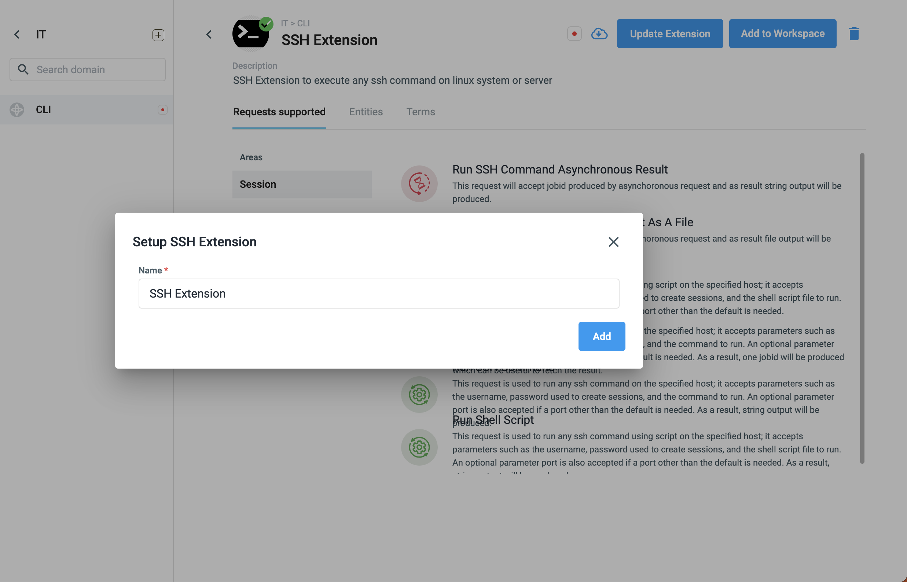
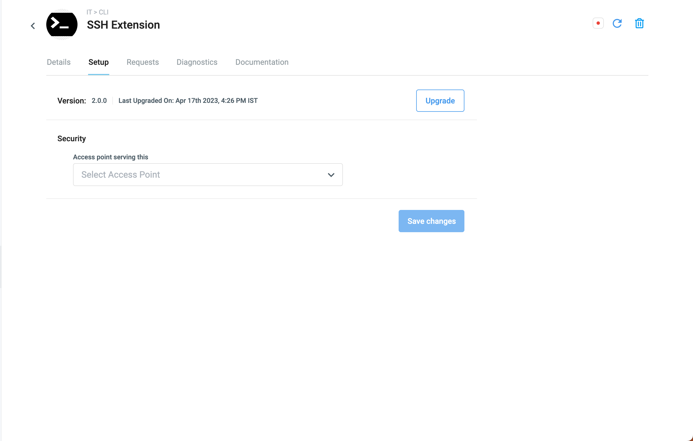

# Extension Configuration

## Overview

This guide explains how to add and configure the SSH Extension in your Krista workspace. The SSH Extension allows you to execute shell commands on remote servers using the SSH protocol.

## Configuration Parameters

The SSH Extension does not require any pre-configuration. All connection parameters are provided at runtime when executing catalog requests.

| Parameter | Type | Required | Description | Example |
|-----------|------|----------|-------------|---------|
| Host Name | Text | Yes | IP address or hostname of the SSH server | `192.168.1.100` or `server.example.com` |
| Port | Number | No | SSH port number (default: 22) | `22` |
| Username | Text | Yes | SSH username for authentication | `admin` |
| Password | Text | Yes | SSH password for authentication | `********` |
| Command | Text | Yes | Shell command to execute | `ls -la /home` |
| Timeout In Seconds | Number | No | Maximum execution time in seconds | `30` |

## Step-by-Step Setup

### Step 1: Navigate to the SSH Extension

Select the SSH extension from the catalog by navigating to:

**Catalog → IT → CLI → Extensions → SSH**

### Step 2: Add Extension to Workspace

Click the "Add to Workspace" button to add the SSH extension to your current workspace.

### Step 3: Extension Ready

The extension is now added to your workspace and ready to use. You can start using SSH catalog requests in your Krista applications.

## Security Considerations

> **⚠️ Warning**: SSH credentials are transmitted securely but should be managed carefully.

1. **Use Strong Passwords** - Ensure SSH passwords meet your organization's security requirements
2. **Limit Access** - Use SSH accounts with minimal required permissions
3. **Network Security** - Ensure network connectivity between Krista and target servers is secure
4. **Audit Logging** - Enable SSH logging on target servers for audit purposes

## Troubleshooting

### Cannot Find Extension in Catalog

**Cause**: Extension may not be installed or you may not have access permissions.

**Solution**: Contact your Krista administrator to verify the SSH extension is installed and you have appropriate access.

### Extension Not Appearing in Workspace

**Cause**: Extension may not have been added successfully.

**Solution**:
1. Refresh the workspace
2. Try adding the extension again
3. Check for any error messages during the add process

## Next Steps

After configuring the extension, you can:

- Learn about [Authentication](pages/Authentication.md) for SSH connections
- Start using [Run SSH Command](pages/RunSSHCommand.md) to execute commands
- Explore [Run SSH Command Asynchronous](pages/RunSSHCommandAsynchronous.md) for long-running commands

## See Also

- [Authentication](pages/Authentication.md)
- [Run SSH Command](pages/RunSSHCommand.md)
- [Release Notes](pages/ReleaseNotes.md)